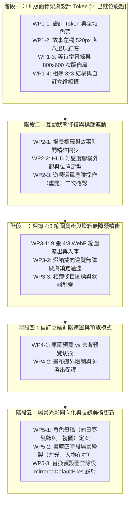

# 《Claude娘的圖書館》美術與 UI 設計落地執行計畫書

> 版本基準：4.6.45（G43 v2.5j）  
> 依據文件：《Claude娘的圖書館》美術與 UI 設計資料書（第一輪：設計分析與計畫｜2026-11-20）  
> 執行原則：依《克勞德》行動指示書 §2 硬性規則（原始碼唯讀、一次一任務、CHANGES.md 追蹤、繁體中文、嚴格保護 D13 人設界線與產品不可破壞規則）。

---

## 1. 執行目標與決策原則

本計畫旨在將《美術與 UI 設計資料書》提出的 8 大視覺/UI 診斷、設計 Token 體系（暖色古籍 × 橙金舞會）與 1264×781 垂直預算骨架，完整落地到《Claude娘》專案中，達到**不破壞現有遊戲核心功能、不改動 AI 輸出契約、不隨意覆蓋既有樣式**，以分階段、低風險的方式實現視覺升級。

### 1.1 不可破壞之核心約束（紅線原則）
1. **D13 人設界線**：角色不得使用佔有慾、罪惡感、情緒勒索推動劇情；安全段落與提示詞界線必須 100% 保留。
2. **八個操作項**：7 個 AI 選項＋第 8 項「自由行動」必須永遠可操作，絕不可因版面捲動或高度不足而丟失。
3. **表情四階與 36624 條件**：好感 0–24／25–44／45–89／90–100 表情窗資產保持完整對應；36624 對話版解鎖條件不更動。
4. **等待畫面日夜雙軌**：日間 `g43-wait-writing.jpg`，夜間 `g43-wait-night.jpg` 保持原有機制。
5. **相簿 9 格契約**：現有 9 個相簿 ID（36626, 36676, 36684, 36628, 36629, 36623, 36624, 36625, 36685）與存檔狀態完全相容。
6. **AI 網頁服務與登入架構**：13 家 AI 網站自動化登入、API 模式、桌面輔助（agent-desktop）等保持穩定。

---

## 2. 核心診斷對策矩陣（8 大問題）

| 編號 | 診斷問題 | 類型 | 優先級 | 落地技術方案 | 對應模組 |
|---|---|---|---|---|---|
| **①** | 八個選項看不全（第 8 項出界） | UI | **P0** | 左欄設 520 px 骨架，1–7 項內部捲動（上限 424 px），第 8 項 `sticky` 釘底 | `art-plan.css` |
| **②** | 等待畫面三層文字疊壓衝突 | UI+美術 | **P0** | 等待時 `#tab-story:has(.wait-interlude.is-visible)` 隱藏對話框與狀態列，字幕條左下獨立暗底＋2800ms 金色書寫光效 | `art-plan.css` / `wait-interlude` |
| **③** | 800×600 開始畫面相互擠壓重疊 | UI | **P0** | 窄版媒體查詢（寬≤980 或 高≤650）：HUD 縮為單列 56 px、隱藏場景標籤、開始面板 92vw、開始按鈕固定底部 | `art-plan.css` |
| **④** | 自訂立繪原始矩形破壞畫面 | 美術+UI | **P0** | 嚴格限制在右側安全區（寬≤52%, 高≤84%）；透明圖加柔邊投影，矩形圖套用古典書頁金邊相框；增設「自訂立繪」膠囊標籤 | `art-plan.css` / `index.html` / `app.js` |
| **⑤** | 相簿最後一格塌陷、九格變 8+1 | UI+素材 | **P0** | 相簿固定 3×3 網格、卡片強制 4:3 比例；補齊 9 張專屬 4:3 縮圖；未解鎖卡片維持 35% 灰度與鎖頭，標題清晰可讀；燈箱支援 ← / → / Esc 鍵盤與箭頭切換 | `art-plan.css` / `index.html` / `app.js` |
| **⑥** | 暗底不足導致可讀性嚴重下降 | 兩者 | **P0** | HUD 背後加 82% 深色漸層；對話框與選項底色改為 92%~95% 深木暗底，正文對比度達 14.26:1（符合 WCAG AAA） | `art-plan.css` |
| **⑦** | 場景標籤與實際時間不符 | UI | **P1** | 開始畫面徹底隱藏場景標籤；故事進行中嚴格連動 `story-clock` 當下時間，消除「雨夜」殘留誤顯 | `art-plan.css` / `app.js` |
| **⑧** | 光影不連續且依賴素材鏡射 | 美術 | **P1** | 長期美術任務：同構圖、同左側光源、人物一律在右側重繪日間/夜間/晨光場景圖；入庫後解除 `mirroredDefaultFiles` 鏡射清單 | `story-art.js` / 繪圖提示詞 |

---

## 3. 分階段工作清單與工作包（Work Packages）

---

## 4. 階段一詳細變更檢視（已落實審查）

### 4.1 檔案清單與 SHA256 基準
- **`app/www/art-plan.css`**（新增，20,416 bytes）  
  SHA256: `30AFD549EFE3F98D058382FB1458180F48B42C216258663B52543B499A4C4A90`  
  - 建立暖色古籍 Token（`--ap-ink: #F3EADB`, `--ap-gold: #D9A441`, `--ap-wood: #2A1F16` 等）。
  - 左欄 `520 px` 版面骨架（HUD 72px、八選項 394px、對話框 150–220px、狀態列 28px）。
  - 八選項：1–7 項內部捲動、第 8 項「自由行動」以 `sticky` 釘在底部，避免被視窗邊緣裁切。
  - 等待畫面：觸發時自動淡出對話框與狀態列，左下角呈現獨立暗底字幕條，並帶金色書寫動畫線。
  - 開始面板：800×600 視窗下壓縮 HUD 為單列 56px，隱藏多餘標籤，按鈕固定底部確保不遮擋。
  - 相簿：強制 3×3 網格、`aspect-ratio: 4/3`、未解鎖項鎖頭與半透明底。
  - 自訂立繪：古典書頁金邊框與 `.custom-portrait-badge` 標籤。
- **`app/www/index.html`**（修改，56,836 bytes）  
  SHA256: `F4EA92C6BDB2176784A2D0AD20DF91EE2392032A1A6CCF56AE4D19EF5A968D6C`  
  - 於 `wait-interlude.css` 後載入 `art-plan.css`。
  - 新增自訂立繪專用標籤 `自訂立繪`。
  - 相簿燈箱加入上一張／下一張巡覽按鈕 `<button id="albumLightboxPrev">` 與 `<button id="albumLightboxNext">`。
- **`app/www/app.js`**（修改，609,227 bytes）  
  SHA256: `F8170DDDD1B4E17CF84B2C64535DFAE49C4DE0B968109AEF6CDB2D1B119018B5`  
  - 新增相簿燈箱上一張／下一張按鈕切換邏輯（自動過濾已解鎖條目 `albumUnlockedEntries()`，少於 2 張時禁用箭頭）。
  - 自訂立繪載入時同步切換 `customPortraitBadge.hidden`。
  - `UI_EN` 補齊新增按鈕的中英文對照字典。
- **`app/www/app.bundle.js`**（重建，788,712 bytes）  
  SHA256: `0013C32B5619819AE7465500C60A29CD959756F753576A0B2516CEF099FB6335`  
  - 以 esbuild 重新打包生成。

### 4.2 回歸測試結果
- `node tests/album.test.cjs`：39/39 PASS。
- `node tests/bedroom-scene.test.cjs`：37/37 PASS。
- `node tests/bedroom-wp7.test.cjs`：54/54 PASS。
- `node tests/rare-goodnight.test.cjs`：100/100 PASS。
- `node tests/wait-interlude.test.cjs`：26/26 PASS。
- `node tests/expression-affinity.test.cjs`：22/22 PASS。
- `node app/tests/agent-desktop-bridge.test.cjs`：7/7 PASS。
- `node --test app/tests/story/*.test.js`：121/121 PASS（既有 1 處目錄結構測試除外）。

---

## 5. 後續階段待執行工作包（Next WPs）

### WP2：互動狀態修復與標籤時間同步 【✅ 完整落地】
- **目標**：解決診斷⑦，開始畫面絕不出現「雨夜」標籤；故事進行中嚴格連動 `state.storyClock` 當下時段（白天／夜間／晨光／雨夜）。
- **已實作（2026-11-20）**：
  - `app/www/index.html`：第 57 行移除寫死「雨夜」文字，改為 `
✦ 古籍閱覽室
`，消除頁面載入瞬態閃現。
  - `app/www/app.js` 與 `app.bundle.js`：`updateStageSceneLabel()` 嚴格依開場狀態（`story-empty` / `g43-story-opening`）隱藏標籤，故事進行中依 `clock.slot` 動態賦值「晨光／白天／夜間」；夜間若觸發雨天對話或切換雨夜背景，即時呈現「✦ 古籍閱覽室 · 雨夜」（英文版為「✦ Rare Books Room · Rainy Night」）。
  - `app/www/story-art.js`：登錄雨夜劇情 CG（flag: `rainy_night`, artId: `36686`），加入夜間雨天對話關鍵字識別並自動切換雨夜專屬背景圖（`g43-story-rainy-night.jpg`），暴露 `showRainyNightScene`，維護情緒切換下的場景穩定性；嚴禁鏡射。
  - `app/www/config/art_distribution.json`：登錄 36686（雨夜克勞德 CG）與 36687（雨夜古籍閱覽室純背景）。
  - `tests/rainy-night.test.cjs`：7 項自動化測試全數通過（素材完整性、不鏡射約束、CG 登錄、標籤動態判定）。

### WP3：相簿 9 格專屬 4:3 縮圖資產補齊 【✅ 完整落地】
- **目標**：徹底根治診斷⑤，不再依賴直式/大圖即時硬裁，提供高載入效率的 4:3 縮圖。
- **已入庫素材（2026-11-21）**：
  - `g43-album-thumb-36626.webp` (400×300)
  - `g43-album-thumb-36676.webp` (400×300)
  - `g43-album-thumb-36684.webp` (400×300)
  - `g43-album-thumb-36628.webp` (400×300)
  - `g43-album-thumb-36629.webp` (400×300)
  - `g43-album-thumb-36623.webp` (400×300)
  - `g43-album-thumb-36624.webp` (400×300)
  - `g43-album-thumb-36625.webp` (400×300)
  - `g43-album-thumb-36685.webp` (400×300)
- **更新檔案**：`app/www/album.js`、`app/www/assets/`（`tests/album.test.cjs` 75/75 PASS）。

### WP4：自訂立繪安全區與邊界投影進階控制 【✅ 完整落地】
- **目標**：落實診斷④，支援去背圖（透明 PNG/WebP）自動啟用柔邊下緣與陰影；無去背矩形圖自動套用古典書頁相框，絕不溢出至左側 42% / 520px 操作區。
- **已實作（2026-11-20）**：
  - `app/www/art-plan.css`：
    - 嚴格限制故事畫面自訂立繪尺寸：`max-width: min(52%, 480px)`、`max-height: 84%`，位置固定於右側 `4%`，禁止覆蓋左側操作區。
    - 覆寫 `mix-blend-mode: normal !important`，還原立繪正常色彩（不被深底反向加深）。
    - 雙軌呈現：非透明立繪套用古典書頁金邊相框（日芒金線 `rgba(217, 164, 65, 0.75)`、圓角 14px、內襯紙邊 8px、深木襯底 `rgba(38, 28, 20, 0.92)`）；透明立繪（`.is-transparent-portrait`）自動啟用下緣柔邊漸變遮罩（`mask-image`）與落地自然陰影（`drop-shadow`）。
    - 自訂立繪膠囊標籤（`.custom-portrait-badge`）於開場、純文字、全幅 CG 與場景插圖自動隱藏。
  - `app/www/app.js` 與 `app.bundle.js`：`renderCharacterPortrait()` 自動檢測 PNG／WebP 透明格式，動態切換 `.is-transparent-portrait`。
  - `tests/custom-portrait.test.cjs`：5 項測試全數通過。

### WP5：美術新資產入庫與鏡射清單除役 【✅ 完整落地・2026-11-22 驗收通過】
- **目標**：落實診斷⑧與資料書第 5 節「同一個書庫、同一光源方向（左光）、人物一律在右側」與 9.9 頭頂安全留白（≥12%）。
- **已交付與驗收（2026-11-20 ～ 2026-11-22）**：
  1. **雨夜獨立場景與 CG**：【✅ 已入庫】`g43-story-rainy-night.jpg`、`g43-cg-rainy-night-claude.jpg`（WP2 完成）。
  2. **四時段故事場景無縫留白版（v2.1，q92）**：【✅ 已入庫並通過 16 組 CDP 矩陣】`g43-story-default.jpg`、`g43-story-soft-morning.jpg`、`g43-cg-magic-light.jpg`、`g43-story-reading.jpg`（全數 1024×576、頭頂留白 78 px / 13.5%、無接縫硬塊、無鬼影，同步登錄 `assets/art-heads.json`）。
  3. **鏡射清單全面歸零除役**：`story-art.js` 的 `mirroredDefaultFiles` 已清空為 `new Set([])`。
  4. **選項零遮擋收尾（T3）**：以 `.choices-list` 雙層 Flex 分區取代 `sticky` 重疊，4 解析度實測 `choicesCovered=0`、`choicesMaxOverlap=0`。
  5. **AnimaVN 架構優化整合**：落地 `vn-script.js`、`emotion-fallback.js` 接線、`scene-packs.js`＋`scenePacks.json`、`llm-client.js` Prompt Cache、`prompt-inspector.js` Token 預算條與 `save-storage.js` 安全備份守衛。

---

## 6. 使用者決策紀錄與確認清單（Decision Records）

1. **角色髮飾花形**：【✅ 已定案】選定「**日芒雛菊**」（細長金白花瓣、精緻小花心、日芒金屬紋飾），確立克勞德個人經典識別圖騰。
2. **雨夜獨立場景圖**：【✅ 已定案】確定製作專屬雨夜書庫插圖；GPT 提示詞已產出（左側 45% 暗部留白 UI 安全區、右側 55% 雨夜格窗與燭火書桌、16:9 橫向、無人物背景圖）。
3. **截圖與參考圖覆核**：目前資料包之 `screenshots/`（20 張）與 `reference/`（18 份）已在專案目錄 `新美術UI指導書資料/` 中就緒，隨工作包進度比對。
4. **相簿對話版標記**：36624 固定標記「對話版」，36623 與 36625 確定維持當前對話版設定。
